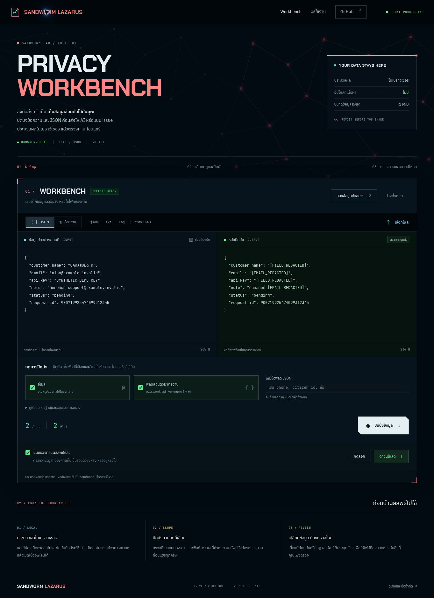

# Sandworm Privacy Workbench

Prepare logs and JSON for sharing, with redaction that runs in your browser.

[คู่มือภาษาไทย](README.th.md) · [Threat model](docs/THREAT_MODEL.md) · [Validation](docs/VALIDATION.md) · [Development](docs/DEVELOPMENT.md)

Privacy Workbench is an original, buildless tool from **Sandworm-Lazarus**. Paste text or open a local file, choose the fields to mask, inspect the result, and export a reviewed copy. Processing needs no account, API key, or dependency installation. The app is designed for offline use.

**Version: 0.1.1.** This is a focused redaction tool, not a guarantee that every sensitive value has been found.



## Sandworm theme

The interface follows the visual identity of [Sandworm Lazarus](https://sandworm-lazarus.pages.dev/): a dark navy background, coral headings, cyan source indicators, green result indicators, and angular controls. The network illustration is original SVG artwork created for this Workbench.

Chakra Petch, Anuphan, and JetBrains Mono are bundled locally, including Thai and Latin subsets where applicable. Typography and artwork load from `dist/`, so the downloaded app needs no external font service. Font licenses and attribution are included in [Third-party notices](THIRD_PARTY_NOTICES.md).

This release updates the presentation while retaining email and JSON-field redaction, the 1 MiB limits, input-safe error messages, and mandatory review before export.

## Try it locally

1. Download or clone this repository.
2. Open [`dist/index.html`](dist/index.html) in a modern browser, or use the local HTTP method below.
3. Paste content or select/drop a `.txt`, `.log`, or `.json` file.
4. Choose text or JSON mode and the redaction rules, then process the input.
5. Review the result, including information outside the selected rules. Confirm the review before copying or downloading.

The app uses local script and style files, so keep the files in `dist/` together. There is no build step. It is designed to open directly with `file://`; this release was browser-tested via local HTTP. The cloud test environment blocked direct-file navigation, so that launch method was not browser-verified here. See [validation details](docs/VALIDATION.md).

For the tested local HTTP approach, run this from the repository root with **Python 3** installed, then open `http://127.0.0.1:8080`:

```sh
python3 -m http.server 8080 --bind 127.0.0.1 --directory dist
```

If Node.js/npm is also available, `npm run serve` runs the same Python command. The local server serves the app's files; processing remains in the browser.

## What it masks

| Input | Rule | Result |
| --- | --- | --- |
| Plain text | Conventional ASCII email addresses | `[EMAIL_REDACTED]` |
| JSON string values | Conventional ASCII email addresses | `[EMAIL_REDACTED]` |
| JSON object values | A selected field name matches exactly, ignoring ASCII letter case | `[FIELD_REDACTED]`, replacing the entire value or subtree |

Default sensitive fields are `customer_name`, `password`, `api_key`, `access_token`, `refresh_token`, `secret`, and `authorization`. Add application-specific names when needed. Non-ASCII characters in field names match exactly; the tool does not normalize Unicode or apply full Unicode case folding.

The custom-field box splits names at commas and trims surrounding whitespace. Names containing commas or leading/trailing whitespace cannot be selected through this interface; the engine API accepts exact names separately.

JSON object keys remain unchanged. Field names match whole names, not substrings: selecting `password` does not select `password_hint`. Names, postal addresses, phone numbers, credentials in arbitrary text, and internationalized email formats are outside the default rules. Review these manually or configure the appropriate JSON fields.

## Small example

Input:

```json
{
  "contact": "demo@example.invalid",
  "api_key": "SYNTHETIC-EXAMPLE-ONLY",
  "request_id": 9007199254740993
}
```

Output with the default rules:

```json
{
  "contact": "[EMAIL_REDACTED]",
  "api_key": "[FIELD_REDACTED]",
  "request_id": 9007199254740993
}
```

All examples are fabricated. JSON number tokens are preserved without conversion to JavaScript numbers, so a large identifier is not silently rounded. Output is formatted with two-space indentation.

File import removes an initial UTF-8 byte-order mark, and the text area normalizes line endings. Plain-text export is a processed copy, not a byte-for-byte file-preservation tool.

## Privacy and limits

- Processing occurs in the browser. The app has no upload endpoint, AI API, analytics, persistent browser storage, or service worker.
- Input and output are each limited to **1 MiB of UTF-8 data**. JSON depth is limited to **32**, with the root at depth zero, and the parsed value count to **50,000 nodes**.
- Invalid JSON, duplicate decoded object keys, malformed Unicode, excessive nesting, and oversized results are rejected. Error messages do not repeat the input.
- Changing the input or rules invalidates the previous export. Copy and download require confirmation that the current result was reviewed.
- Clearing removes the app's current input and result. It does not promise secure erasure from browser memory, clipboard history, downloaded files, or operating-system storage.

A hosted demo needs network access to load its page and may use hosting authentication. That is separate from the app's handling of file contents. Use the downloaded copy when you need the complete workflow offline. See the [threat model](docs/THREAT_MODEL.md) for the boundary of these guarantees.

## Development and checks

Node.js **20 or newer** is needed for development checks and the optional npm command wrapper, not for browser processing or the direct Python server command.

```sh
npm test
npm run verify
```

There are no production dependencies to install. Tests use fabricated inputs and cover parsing, redaction, preservation, invalid input, and resource limits. The workflow in [`.github/workflows/verify.yml`](.github/workflows/verify.yml) runs checks on pushes and pull requests; a workflow file alone does not establish that a hosted run passed.

The initial local run passed **59 tests** on Node.js 24.22.1. See [VALIDATION.md](docs/VALIDATION.md) for browser checks and verification limits.

## Original work and attribution

This browser implementation grows from the original Python Privacy Guard in [Sandworm Arsenal](https://github.com/Sandworm-Lazarus/sandworm-arsenal). The new work includes a bounded JSON parser that preserves number tokens, browser interactions, review-before-export behavior, and browser-focused tests.

It is not a byte-for-byte port. In particular, the Python tool uses Unicode case folding for field matching; this app folds ASCII letters only. Development decisions and validation scope are recorded in [Development](docs/DEVELOPMENT.md).

Application code and original artwork are released under the [MIT License](LICENSE). Bundled fonts retain their SIL Open Font License 1.1; see [Third-party notices](THIRD_PARTY_NOTICES.md). For reporting a problem involving sensitive data, read [SECURITY.md](SECURITY.md).

## Optional cloud worker integration

[Presidio Thai pattern worker](integrations/presidio/README.md) adds a separately run integration with pinned upstream dependencies, synthetic fixtures, regression tests and SHA-256 validation records. See its guide for installation, privacy boundaries and verified integration scope. The browser application remains independently usable.

## Presidio report review (0.2.0)

The [Presidio worker](integrations/presidio/README.md) now supports choosing Thai PII types, a score threshold and bounded exact custom terms. Run it in your local/cloud Python environment, then import its schema 2 JSON into the **Presidio** section of the existing UI. Import clears the source, shows redacted text with finding metadata, and preserves review-before-export. The browser does not run Python or upload data. Source claims in imported reports are not authenticated.
