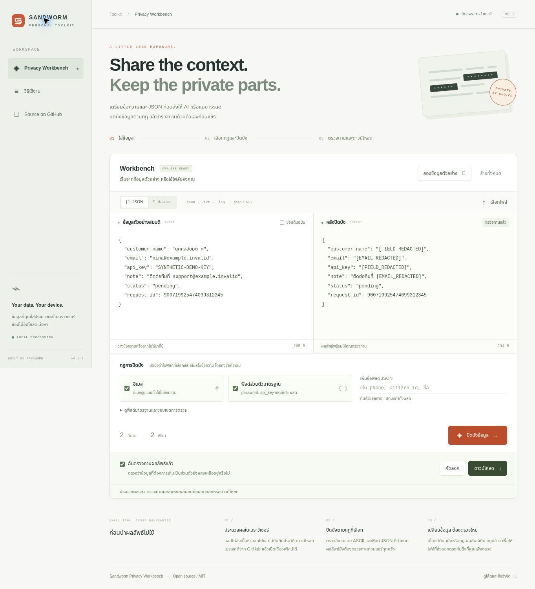

# Sandworm Privacy Workbench

เครื่องมือปิดบังข้อมูลใน log และ JSON ก่อนนำไปแชร์ ประมวลผลในเบราว์เซอร์

[English](README.md) · [ขอบเขตความปลอดภัย](docs/THREAT_MODEL.md) · [ผลการตรวจสอบ](docs/VALIDATION.md) · [บันทึกการพัฒนา](docs/DEVELOPMENT.md)

ผลงานของ **Sandworm-Lazarus** สำหรับวางข้อความหรือเปิดไฟล์ในเครื่อง เลือกฟิลด์ที่ต้องการปิดบัง ตรวจผล แล้วส่งออกสำเนาที่ตรวจทานแล้ว ออกแบบให้ใช้ออฟไลน์ได้ โดยไม่ต้องมีบัญชีหรือ API key ในการประมวลผล

**เวอร์ชัน 0.1.0** ตรวจเฉพาะรูปแบบและฟิลด์ที่กำหนด จึงยังต้องตรวจข้อมูลด้วยตนเองก่อนแชร์



## เริ่มใช้งาน

1. ดาวน์โหลดหรือ clone repo นี้
2. เปิด [`dist/index.html`](dist/index.html) ด้วยเบราว์เซอร์รุ่นปัจจุบัน โดยเก็บไฟล์อื่นใน `dist/` ไว้ด้วยกัน หรือใช้วิธีเปิดผ่าน local HTTP ด้านล่าง
3. วางข้อความ เลือกไฟล์ หรือลากไฟล์ `.txt`, `.log`, `.json` เข้ามา
4. เลือกโหมดข้อความหรือ JSON และกฎปิดบังข้อมูล จากนั้นสั่งประมวลผล
5. ตรวจผลและข้อมูลที่กฎอาจไม่ครอบคลุม แล้วทำเครื่องหมายยืนยันการตรวจทานก่อนคัดลอกหรือดาวน์โหลด

ไม่ต้อง build หรือติดตั้ง dependencies ออกแบบให้เปิดไฟล์โดยตรงผ่าน `file://` ได้ แต่รุ่นนี้ทดสอบเบราว์เซอร์ผ่าน local HTTP เท่านั้น สภาพแวดล้อมคลาวด์ที่ใช้ทดสอบบล็อกการเปิดไฟล์โดยตรง จึงยังไม่ได้ยืนยันวิธี `file://` ด้วยเบราว์เซอร์ในรอบนี้ ดู [ผลการตรวจสอบ](docs/VALIDATION.md)

วิธีเปิดผ่าน local HTTP ที่ใช้ในการทดสอบ: ติดตั้ง **Python 3** แล้วรันจากโฟลเดอร์ repo จากนั้นเปิด `http://127.0.0.1:8080`

```sh
python3 -m http.server 8080 --bind 127.0.0.1 --directory dist
```

หากมี Node.js/npm ด้วย สามารถใช้ `npm run serve` เพื่อเรียกคำสั่ง Python เดียวกันได้ เซิร์ฟเวอร์นี้ให้บริการไฟล์หน้าเว็บ ส่วนการประมวลผลข้อมูลอยู่ในเบราว์เซอร์

## ปิดบังอะไรได้บ้าง

| ข้อมูล | วิธีตรวจ | ข้อความแทนที่ |
| --- | --- | --- |
| ข้อความทั่วไป | อีเมลรูปแบบ ASCII ที่รองรับ | `[EMAIL_REDACTED]` |
| ค่าข้อความใน JSON | อีเมลรูปแบบ ASCII ที่รองรับ | `[EMAIL_REDACTED]` |
| ค่าของฟิลด์ JSON | ชื่อฟิลด์ตรงกับรายการที่เลือก โดยไม่แยกตัวพิมพ์ใหญ่–เล็กของอักษร ASCII | `[FIELD_REDACTED]` แทนค่าทั้งก้อน |

ฟิลด์เริ่มต้นคือ `customer_name`, `password`, `api_key`, `access_token`, `refresh_token`, `secret` และ `authorization` สามารถเพิ่มชื่อฟิลด์เฉพาะงานได้ ชื่อภาษาไทยและอักขระนอก ASCII ต้องตรงกันทุกตัว ไม่มีการแปลงรูป Unicode

ช่องเพิ่มฟิลด์ใช้จุลภาคคั่นชื่อและตัดช่องว่างหัว–ท้าย จึงเลือกชื่อที่มีจุลภาคหรือช่องว่างหัว–ท้ายผ่านหน้าจอนี้ไม่ได้ ส่วน engine API รับชื่อแบบตรงตัวแยกเป็นรายการได้

ชื่อ key ใน JSON ยังคงเดิม การเลือก `password` จะไม่ครอบคลุม `password_hint` โดยอัตโนมัติ ส่วนชื่อบุคคล ที่อยู่ เบอร์โทร รหัสลับในข้อความทั่วไป และอีเมลนอกขอบเขตที่รองรับ ยังต้องตรวจเองหรือกำหนดฟิลด์ JSON เพิ่ม

## ตัวอย่างข้อมูลสมมติ

```json
{
  "contact": "demo@example.invalid",
  "api_key": "SYNTHETIC-EXAMPLE-ONLY",
  "request_id": 9007199254740993
}
```

เมื่อใช้กฎเริ่มต้น:

```json
{
  "contact": "[EMAIL_REDACTED]",
  "api_key": "[FIELD_REDACTED]",
  "request_id": 9007199254740993
}
```

ตัวเลขใน JSON คงรูปเดิมโดยไม่แปลงเป็น JavaScript number จึงไม่ทำให้เลข ID ขนาดใหญ่ถูกปัดเศษ ผลลัพธ์จัดรูปแบบโดยย่อหน้าด้วยช่องว่างสองตัว

การนำเข้าไฟล์จะตัด UTF-8 byte-order mark ที่ต้นไฟล์ และช่องข้อความปรับรูปแบบการขึ้นบรรทัดใหม่ ผลลัพธ์ข้อความจึงเป็นสำเนาที่ประมวลผลแล้ว ไม่ใช่การเก็บไฟล์เดิมให้ตรงกันทุกไบต์

## ความเป็นส่วนตัวและข้อจำกัด

- ประมวลผลในเบราว์เซอร์ ไม่มีระบบอัปโหลด เรียก AI API วิเคราะห์ผู้ใช้ เก็บข้อมูลใน persistent browser storage หรือ service worker
- จำกัดข้อมูลเข้าและออกอย่างละ **1 MiB แบบ UTF-8**; JSON ลึกได้สูงสุด **32 ระดับ** โดย root มีความลึกเป็นศูนย์ และมีค่าได้สูงสุด **50,000 nodes**
- ปฏิเสธ JSON ผิดรูปแบบ key ซ้ำหลังถอดรหัส Unicode ผิดรูปแบบ ข้อมูลซ้อนลึกเกินไป และผลลัพธ์เกินขนาด โดยข้อความผิดพลาดไม่แสดงข้อมูลต้นฉบับ
- เมื่อแก้ข้อมูลหรือกฎ ต้องประมวลผลและตรวจทานใหม่ก่อนส่งออก
- ปุ่มล้างข้อมูลล้างสถานะของแอป แต่ไม่ได้รับรองการลบอย่างกู้คืนไม่ได้จากหน่วยความจำ ประวัติคลิปบอร์ด ไฟล์ดาวน์โหลด หรือระบบปฏิบัติการ

เดโมที่มีโฮสต์ต้องใช้อินเทอร์เน็ตเพื่อโหลดหน้าและอาจมีระบบเข้าสู่ระบบของโฮสต์ การโหลดหน้านี้เป็นคนละส่วนกับการประมวลผลเนื้อหาไฟล์ หากต้องการใช้ออฟไลน์ครบขั้นตอน ให้เปิดสำเนาที่ดาวน์โหลดไว้

## สำหรับผู้พัฒนา

ใช้ Node.js **20 ขึ้นไป** เพื่อรันการตรวจสอบและคำสั่งผ่าน npm ส่วนการประมวลผลในเบราว์เซอร์หรือการเรียก Python server โดยตรงไม่ต้องมี Node.js

```sh
npm test
npm run verify
```

ใช้ข้อมูลสมมติในการทดสอบ มี workflow สำหรับรัน checks เมื่อ push หรือเปิด pull request แต่การมีไฟล์ workflow ไม่ได้หมายความว่า hosted CI ผ่านแล้ว ให้ดูผลของแต่ละ run ประกอบ

การตรวจสอบในเครื่องรอบแรกผ่าน **59 tests** บน Node.js 24.22.1 รายละเอียดการลองในเบราว์เซอร์และข้อจำกัดอยู่ใน [VALIDATION.md](docs/VALIDATION.md)

## ผลงานและที่มา

พัฒนาต่อจากแนวคิดของ Python Privacy Guard ที่เราเขียนไว้ใน [Sandworm Arsenal](https://github.com/Sandworm-Lazarus/sandworm-arsenal) โดยเพิ่มตัวอ่าน JSON ที่คงรูปตัวเลข หน้าจอใช้งาน ขั้นตอนตรวจทานก่อนส่งออก และการทดสอบสำหรับงานเบราว์เซอร์

พฤติกรรมไม่เหมือน Python ทุกกรณี: เวอร์ชัน Python จับคู่ชื่อฟิลด์ด้วย Unicode case folding ส่วนแอปนี้ไม่แยกตัวพิมพ์ใหญ่–เล็กเฉพาะอักษร ASCII ดูรายละเอียดใน [บันทึกการพัฒนา](docs/DEVELOPMENT.md)

เผยแพร่ภายใต้ [MIT License](LICENSE) และมีแนวทางรายงานปัญหาใน [SECURITY.md](SECURITY.md)
